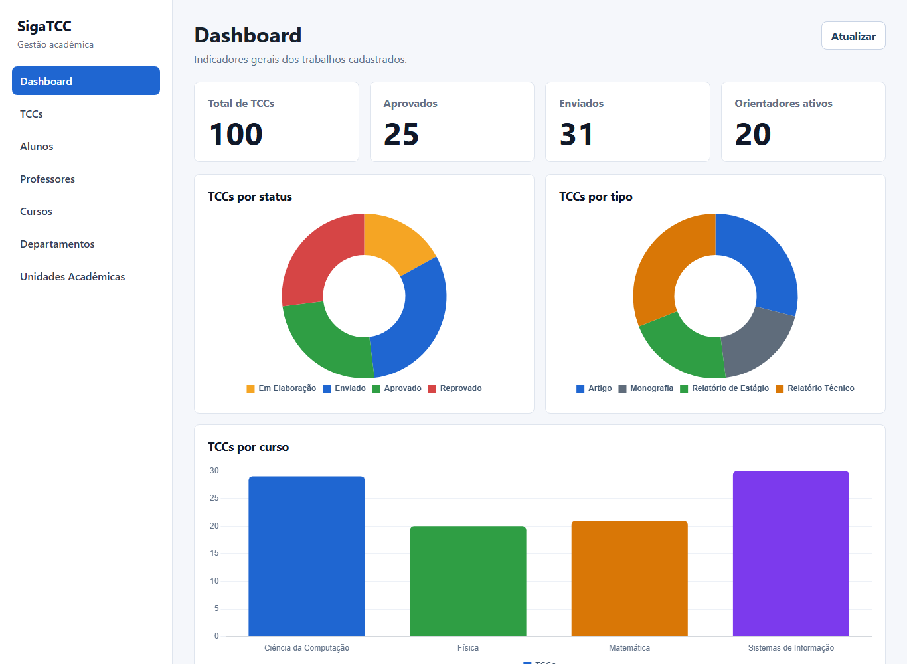
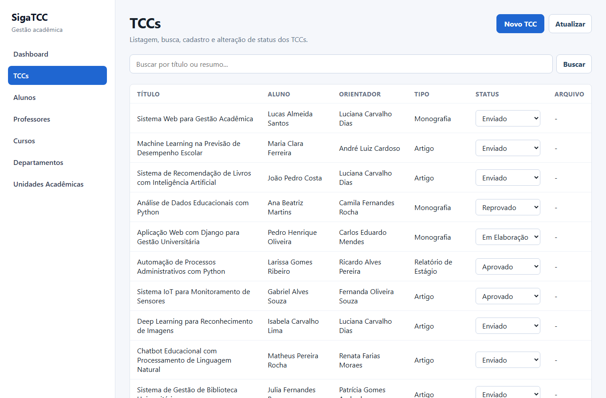

# SigaTCC — Sistema de Gestão de TCCs

[](https://github.com/DPontello/SigaTCC/actions/workflows/ci.yml)

## O que é

Sistema para gerenciamento de Trabalhos de Conclusão de Curso (TCCs): cadastro com upload do PDF, busca, controle de status (Em Elaboração → Enviado → Aprovado/Reprovado) e um dashboard com indicadores por status, tipo, curso, orientador e departamento.

Desenvolvido com **Django REST Framework** no backend e **Vue.js 3** no frontend, como projeto acadêmico em equipe na UFLA.



<details>
<summary>Tela de listagem e busca de TCCs</summary>



</details>

> Os dados das imagens são fictícios, gerados pelo script `load.py`.

## Equipe

| Pessoa | Principais contribuições |
|--------|--------------------------|
| [Hugo Pontello](https://github.com/DPontello) | Modelagem do banco e API REST (models, serializers, viewsets, endpoint de estatísticas), script de carga de dados, containerização com Docker, testes automatizados e CI |
| [João Guilherme](https://github.com/joaogsribeiro) | Frontend Vue (base, dashboard com Chart.js, formulário com upload de PDF) |
| [Ruan Pablo](https://github.com/FixRuan) | Telas de listagem de TCCs e das entidades (alunos, professores, cursos, departamentos, unidades) |

## Tecnologias

| Camada | Tecnologia |
|--------|------------|
| Backend | Python 3.12, Django 6, Django REST Framework |
| Frontend | Vue.js 3, Vue Router, Vite, Chart.js |
| Banco de dados | SQLite (modelo relacional com 6 entidades) |
| Containerização | Docker, Docker Compose |
| Qualidade | Testes de API com `APITestCase` (DRF), GitHub Actions (CI) |

## Funcionalidades implementadas

- **Dashboard** com gráficos de TCCs por status e por orientador (Chart.js)
- **Listagem e busca** de TCCs com filtros por título, aluno e status
- **Cadastro de TCC** com upload de arquivo PDF
- **Visualização e download** do arquivo PDF na listagem
- **Listagem** de Alunos, Professores, Cursos, Departamentos e Unidades Acadêmicas

---

## Como rodar com Docker (recomendado)

Pré-requisito: [Docker Desktop](https://www.docker.com/products/docker-desktop) instalado e em execução.

```bash
# Sobe o backend (porta 8000) e o frontend (porta 5173)
docker compose up --build
```

Na primeira vez, popule o banco com dados de exemplo:

```bash
docker compose exec backend python load.py
```

Acesse:
- **Frontend:** http://localhost:5173
- **API:** http://localhost:8000/api/

Para parar:

```bash
docker compose down
```

---

## Como rodar sem Docker

### Backend

```bash
# 1. Crie e ative o ambiente virtual
python -m venv venv

# Linux/macOS:
source venv/bin/activate
# Windows:
venv\Scripts\activate

# 2. Instale as dependências
pip install -r requirements.txt

# 3. Rode as migrações
python manage.py migrate

# 4. Popule o banco com dados de exemplo
python load.py

# 5. Inicie o servidor
python manage.py runserver
```

API disponível em: http://127.0.0.1:8000/api/

### Frontend

```bash
cd frontend

# 1. Copie o arquivo de variáveis de ambiente
cp .env.example .env
# O arquivo já aponta para http://127.0.0.1:8000/api por padrão

# 2. Instale as dependências
npm install

# 3. Inicie o servidor de desenvolvimento
npm run dev
```

Frontend disponível em: http://localhost:5173

---

## Como popular dados

O script `load.py` na raiz do projeto limpa e repopula o banco com dados fictícios (unidades acadêmicas, departamentos, cursos, professores, alunos e TCCs).

```bash
# Sem Docker:
python load.py

# Com Docker (container em execução):
docker compose exec backend python load.py
```

---

## Exemplo de uso

Com o backend rodando e o banco populado (`python load.py`):

```bash
curl http://127.0.0.1:8000/api/tccs/estatisticas/
```

Resposta (trecho real com os dados de exemplo):

```json
{
  "total_geral": 100,
  "por_status": { "Em Elaboração": 17, "Enviado": 31, "Aprovado": 25, "Reprovado": 27 },
  "por_tipo": { "Artigo": 29, "Monografia": 19, "Relatório de Estágio": 21, "Relatório Técnico": 31 },
  "por_idioma": { "Inglês": 50, "Português": 50 }
}
```

Busca por título ou resumo: `GET /api/tccs/?search=Django`

---

## Testes

```bash
python manage.py test core -v 2
```

Os testes cobrem listagem, busca, criação (com status padrão), validação de campos obrigatórios, alteração de status e as agregações do endpoint de estatísticas. Eles rodam automaticamente no GitHub Actions a cada push, junto com o build do frontend.

---

## Endpoints da API

| Recurso | URL |
|---------|-----|
| Unidades Acadêmicas | `GET /api/unidades-academicas/` |
| Departamentos | `GET /api/departamentos/` |
| Cursos | `GET /api/cursos/` |
| Alunos | `GET /api/alunos/` |
| Professores | `GET /api/professores/` |
| TCCs | `GET /api/tccs/` |
| Estatísticas (Dashboard) | `GET /api/tccs/estatisticas/` |

### Status dos TCCs

| Código | Descrição |
|--------|-----------|
| `0` | Em Elaboração |
| `1` | Enviado |
| `2` | Aprovado |
| `3` | Reprovado |

### Upload de arquivo

O campo `arquivo` (PDF) deve ser enviado via `multipart/form-data` no cadastro de TCC.

### Estrutura do endpoint de estatísticas

```json
{
    "total_geral": 10,
    "por_status": {
        "Aprovado": 3,
        "Em Elaboração": 2
    },
    "por_orientador": {
        "Prof. Ana Paula Ribeiro": 4
    }
}
```

---

## Material de apoio

- [Django REST Framework](https://www.django-rest-framework.org/)
- [Vue.js 3](https://vuejs.org/)
- [Vite](https://vite.dev/)
- [Chart.js](https://www.chartjs.org/)
